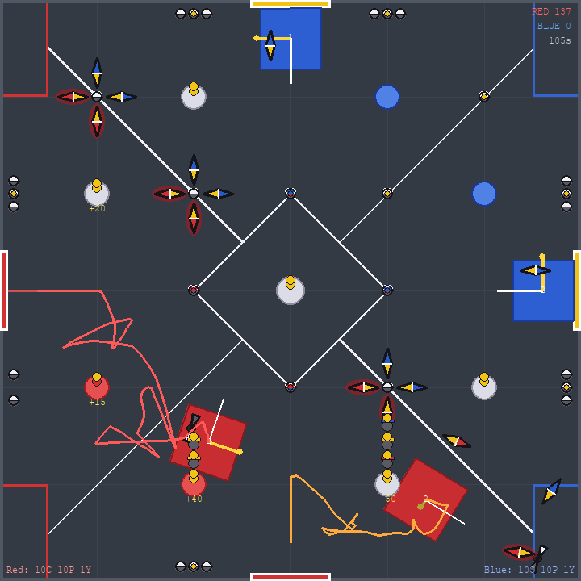
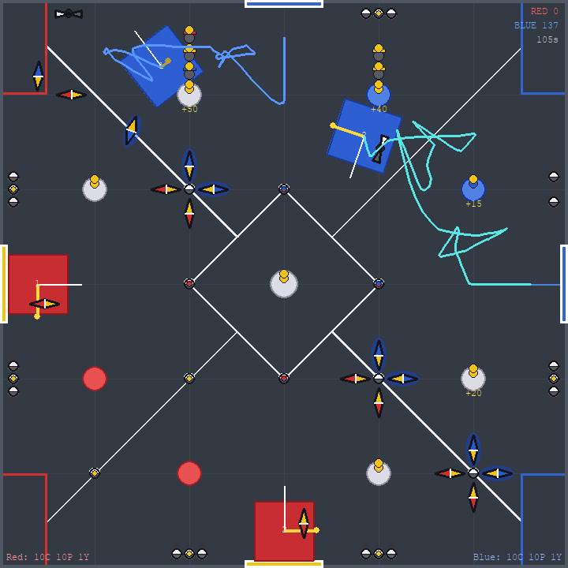
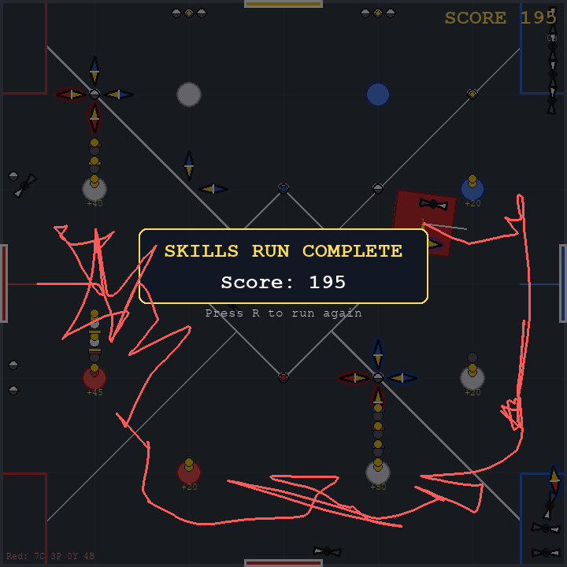

# Override routes — robot profile `user_robot`

Generated by `python -m strategy.find_routes`.  Planned = planner's prediction; Physics = score the pymunk simulator actually awarded when the route was driven.

Robot: front intake (any element), back intake (standing pins only), scores only out of the back.  Edit `config/robot_profile.py` to match your real speeds/timings and re-run.  In auton routes the running '→ pts' total includes the partner robot's placements (robots are planned around each other's full route).


## Autonomous — red alliance, objective: points

Planned **125** pts, physics **125** pts. AWP in physics: **True** (13 scored pins, 4 goals with 2+, off perimeter: True).




**red1** (start (9.5, 72)):
```
 1. t≈ 1.03s  set toggle 1 (left wall) to red  → 70 pts
 2. t≈ 3.18s  reverse onto R-High and place pin (flip pin)  → 85 pts
 3. t≈ 4.83s  front-intake cup+yellow_yellow @(2,96)
 4. t≈ 7.26s  reverse onto R-Low and place pin then cup  → 105 pts
 5. t≈ 8.70s  front-intake cup+yellow_yellow @(24,120)
 6. t≈10.19s  reverse onto R-Low and place pin then cup (flip cup)  → 115 pts
 7. t≈12.06s  front-intake cup+yellow_yellow @(48,96)
 8. t≈13.44s  reverse onto R-Low and place pin  → 125 pts
```


**red2** (start (72, 134.5)):
```
 1. t≈ 1.03s  set toggle 4 (bottom wall) to red  → 95 pts
 2. t≈ 3.06s  front-intake cup @(99,142)
 3. t≈ 5.01s  reverse onto SE and place cup then pin (flip pin)  → 105 pts
 4. t≈ 6.16s  front-intake cup+yellow_yellow @(96,142)
 5. t≈ 7.50s  reverse onto SE and place cup then pin  → 115 pts
 6. t≈ 9.62s  front-intake blue_yellow pin @(120,114)
 7. t≈10.24s  front-intake cup @(120,120)
 8. t≈11.69s  reverse onto SE and place cup then pin (flip pin) (flip cup)  → 125 pts
```


## Autonomous — red alliance, objective: awp

Planned **125** pts, physics **125** pts. AWP in physics: **True** (13 scored pins, 4 goals with 2+, off perimeter: True).


**red1** (start (9.5, 72)):
```
 1. t≈ 1.03s  set toggle 1 (left wall) to red  → 70 pts
 2. t≈ 3.18s  reverse onto R-High and place pin (flip pin)  → 85 pts
 3. t≈ 4.83s  front-intake cup+yellow_yellow @(2,96)
 4. t≈ 7.26s  reverse onto R-Low and place pin then cup  → 105 pts
 5. t≈ 8.70s  front-intake cup+yellow_yellow @(24,120)
 6. t≈10.19s  reverse onto R-Low and place pin then cup (flip cup)  → 115 pts
 7. t≈12.06s  front-intake cup+yellow_yellow @(48,96)
 8. t≈13.44s  reverse onto R-Low and place pin  → 125 pts
```


**red2** (start (72, 134.5)):
```
 1. t≈ 1.03s  set toggle 4 (bottom wall) to red  → 95 pts
 2. t≈ 3.06s  front-intake cup @(99,142)
 3. t≈ 5.01s  reverse onto SE and place cup then pin (flip pin)  → 105 pts
 4. t≈ 6.16s  front-intake cup+yellow_yellow @(96,142)
 5. t≈ 7.50s  reverse onto SE and place cup then pin  → 115 pts
 6. t≈ 9.62s  front-intake blue_yellow pin @(120,114)
 7. t≈10.24s  front-intake cup @(120,120)
 8. t≈11.69s  reverse onto SE and place cup then pin (flip pin) (flip cup)  → 125 pts
```


## Autonomous — blue alliance, objective: points

Planned **125** pts, physics **125** pts. AWP in physics: **True** (13 scored pins, 4 goals with 2+, off perimeter: True).




**blue2** (start (134.5, 72)):
```
 1. t≈ 1.03s  set toggle 2 (right wall) to blue  → 70 pts
 2. t≈ 3.18s  reverse onto B-High and place pin (flip pin)  → 85 pts
 3. t≈ 4.83s  front-intake cup+yellow_yellow @(142,48)
 4. t≈ 7.26s  reverse onto B-Low and place pin then cup  → 105 pts
 5. t≈ 8.70s  front-intake cup+yellow_yellow @(120,24)
 6. t≈10.19s  reverse onto B-Low and place pin then cup (flip cup)  → 115 pts
 7. t≈12.06s  front-intake cup+yellow_yellow @(96,48)
 8. t≈13.44s  reverse onto B-Low and place pin  → 125 pts
```


**blue1** (start (72, 9.5)):
```
 1. t≈ 1.03s  set toggle 3 (top wall) to blue  → 95 pts
 2. t≈ 3.06s  front-intake cup @(45,2)
 3. t≈ 5.01s  reverse onto NW and place cup then pin (flip pin)  → 105 pts
 4. t≈ 6.16s  front-intake cup+yellow_yellow @(48,2)
 5. t≈ 7.50s  reverse onto NW and place cup then pin  → 115 pts
 6. t≈ 9.62s  front-intake red_yellow pin @(24,30)
 7. t≈10.24s  front-intake cup @(24,24)
 8. t≈11.69s  reverse onto NW and place cup then pin (flip pin) (flip cup)  → 125 pts
```


## Autonomous — blue alliance, objective: awp

Planned **125** pts, physics **125** pts. AWP in physics: **True** (13 scored pins, 4 goals with 2+, off perimeter: True).


**blue2** (start (134.5, 72)):
```
 1. t≈ 1.03s  set toggle 2 (right wall) to blue  → 70 pts
 2. t≈ 3.18s  reverse onto B-High and place pin (flip pin)  → 85 pts
 3. t≈ 4.83s  front-intake cup+yellow_yellow @(142,48)
 4. t≈ 7.26s  reverse onto B-Low and place pin then cup  → 105 pts
 5. t≈ 8.70s  front-intake cup+yellow_yellow @(120,24)
 6. t≈10.19s  reverse onto B-Low and place pin then cup (flip cup)  → 115 pts
 7. t≈12.06s  front-intake cup+yellow_yellow @(96,48)
 8. t≈13.44s  reverse onto B-Low and place pin  → 125 pts
```


**blue1** (start (72, 9.5)):
```
 1. t≈ 1.03s  set toggle 3 (top wall) to blue  → 95 pts
 2. t≈ 3.06s  front-intake cup @(45,2)
 3. t≈ 5.01s  reverse onto NW and place cup then pin (flip pin)  → 105 pts
 4. t≈ 6.16s  front-intake cup+yellow_yellow @(48,2)
 5. t≈ 7.50s  reverse onto NW and place cup then pin  → 115 pts
 6. t≈ 9.62s  front-intake red_yellow pin @(24,30)
 7. t≈10.24s  front-intake cup @(24,24)
 8. t≈11.69s  reverse onto NW and place cup then pin (flip pin) (flip cup)  → 125 pts
```


## Robot Skills (60 s, driver or programming)

Planned **223** pts, physics **195** pts.



```
 1. t≈ 1.03s  set toggle 1 (left wall) to red  → 0 pts
 2. t≈ 3.18s  reverse onto R-High and place pin (flip pin)  → 15 pts
 3. t≈ 4.83s  front-intake cup+yellow_yellow @(2,96)
 4. t≈ 7.22s  reverse onto SW and place pin then cup  → 35 pts
 5. t≈ 8.98s  front-intake cup+yellow_yellow @(2,48)
 6. t≈10.31s  reverse onto SW and place pin  → 45 pts
 7. t≈12.57s  front-intake red_yellow pin @(42,48)
 8. t≈13.57s  reverse onto SW and place cup then pin (flip pin)  → 55 pts
 9. t≈14.75s  front-intake red_yellow pin @(48,54)
10. t≈15.36s  front-intake cup @(48,48)
11. t≈17.78s  reverse onto R-High and place cup then pin (flip pin) (flip cup)  → 65 pts
12. t≈19.57s  front-intake cup+yellow_yellow @(48,96)
13. t≈21.10s  reverse onto R-High and place cup then pin  → 75 pts
14. t≈23.15s  front-intake cup+yellow_yellow @(24,120)
15. t≈24.65s  reverse onto R-High and place cup then pin  → 85 pts
16. t≈26.58s  front-intake cup+yellow_yellow @(48,142)
17. t≈28.85s  set toggle 4 (bottom wall) to red  → 85 pts
18. t≈31.34s  reverse onto SE and place pin then cup  → 105 pts
19. t≈32.99s  front-intake cup+yellow_yellow @(96,142)
20. t≈35.22s  reverse onto R-Low and place pin  → 125 pts
21. t≈37.62s  front-intake blue_yellow pin @(126,120)
22. t≈38.95s  reverse onto SE and place pin (flip pin)  → 135 pts
23. t≈39.30s  front-intake red_yellow pin @(114,120)
24. t≈40.30s  reverse onto SE and place cup then pin (flip pin)  → 145 pts
25. t≈41.54s  front-intake blue_yellow pin @(120,114)
26. t≈42.15s  front-intake cup @(120,120)
27. t≈43.64s  reverse onto SE and place cup then pin (flip pin) (flip cup)  → 155 pts
28. t≈45.58s  front-intake cup+yellow_yellow @(142,96)
29. t≈47.85s  set toggle 2 (right wall) to blue  → 155 pts
30. t≈49.59s  reverse onto NE and place pin  → 175 pts
31. t≈50.04s  reverse onto NE and place cup  → 175 pts
32. t≈51.90s  front-intake cup+yellow_yellow @(142,48)
33. t≈53.73s  reverse onto B-High and place pin  → 195 pts
34. t≈55.41s  back-intake the yellow_yellow pin standing in cup @(96,48)
35. t≈57.49s  reverse onto Center and place pin  → 195 pts
36. t≈57.49s  drive into the Midfield and stay there  → 223 pts
```
